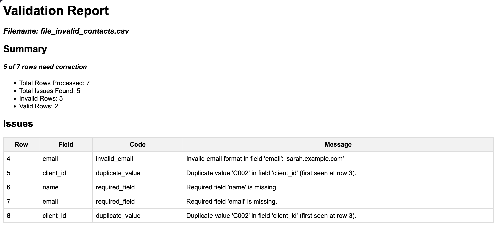

# file-validator

A Python command-line tool that checks contact CSV files before import.
It generates an HTML report showing which rows need correction and why.



## Quick start

From the repository root, run the following command with Python 3.12.
The tool uses only the Python standard library.

```bash
python -m main examples/file_invalid_contacts.csv
```

Open `report_file_invalid_contacts.html` in your browser. This example
contains seven contacts. The report flags five rows and lists the issues
in CSV row order, with the header counted as row 1.

## What it checks

The tool reads UTF-8 contact CSV files and checks the header before
validating the contacts.

- The header must include `client_id`, `name`, and `email`.
- Each contact must have a value in those three columns.
- Duplicate client IDs are flagged with the row number of the first occurrence.
- If an email address is provided, the tool checks its format.

The sample files also include `city` and `country`.

## Example files

| Input file in `examples/` | Expected report |
| --- | --- |
| `file_invalid_contacts.csv` | Seven contacts checked, five rows need correction |
| `file_valid_header_and_contacts.csv` | All seven contacts are valid |
| `file_invalid_header_and_contacts.csv` | The required `email` column is missing |
| `file_valid_header_and_no_contact.csv` | The header is valid and no data rows were processed |
| `file_empty.csv` | The file is empty or missing a header row |

## Report location

By default, the report is saved in the current directory as
`report_<input-name>.html`, using the input filename without its extension.

Use `-o` or `--output` to choose a different path.

```bash
python -m main examples/file_invalid_contacts.csv -o contacts-check.html
```

The output directory must already exist. If the output extension is
missing or differs from `.html`, the tool sets it to `.html`.

Run `python -m main --help` to see the command-line options.

## Tests

```bash
python -m unittest discover -s tests -v
```

The unit tests cover header validation, required values, duplicate IDs,
and basic email format. The CSV files in `examples/` let you check the
command-line output and HTML reports manually.